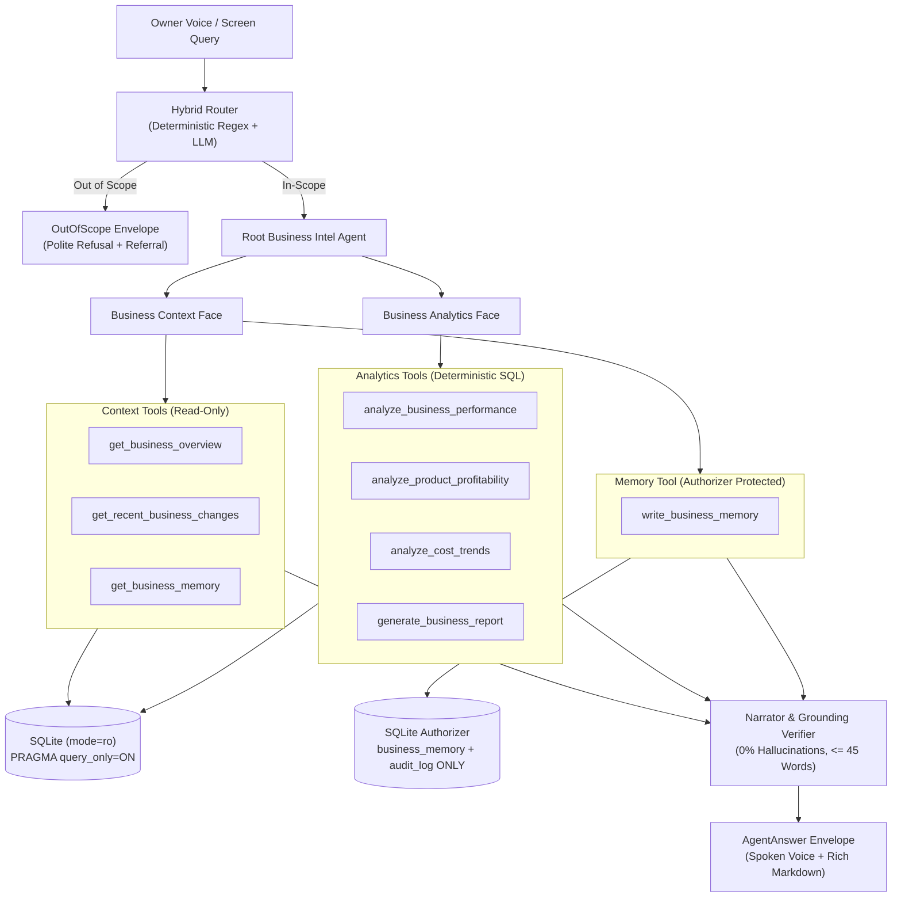

# Alexa Business Autopilot: Business Intel Agent

The **Business Intel Agent** is the combined **Business Context Agent + Business Analytics Agent** for **Alexa Business Autopilot**, a voice-first business intelligence copilot for Indian owner-operated small enterprises.

- **Archetype:** "Maa Ki Rasoi Cloud Kitchen", Kakadeo, Kanpur, Uttar Pradesh
- **Menu Item:** Standard Veg Tiffin (₹90 one-off, ₹85 subscription)
- **Frozen Clock:** `2026-10-10T19:10:00+05:30` (Saturday), Tomorrow = `2026-10-11` (Sunday)
- **Deployment Target:** Standalone component with two specialist faces + MCP Server + Orchestrator Adapter

---

## Architecture



---

## Core Design Invariants

1. **Deterministic Execution:** No LLM arithmetic. All numbers (revenue, COGS, contribution margin, breakeven volume, delta percentages) are precomputed by deterministic Python/SQL tools.
2. **Frozen Clock:** Anchored to `meta.as_of = 2026-10-10T19:10:00+05:30`. Never uses host system clocks (`datetime.now()`). Asking for "today" automatically warns that today is partial as of 19:10.
3. **Read-Only by Construction:**
   - 7 query tools use a read-only SQLite URI (`mode=ro`) and `PRAGMA query_only=ON`.
   - `write_business_memory` uses a dedicated connection equipped with a strict `sqlite3` authorizer that permits INSERT/UPDATE solely on `business_memory` and INSERT on `audit_log`. All other table writes or schema changes raise permission errors.
4. **Computed Confidence:** Mathematical formula:
   $$\text{Confidence} = \text{clamp}(1.0 \times F_{\text{coverage}} \times F_{\text{forecast}} \times F_{\text{conflict}} \times F_{\text{sample}}, 0.0, 1.0)$$
5. **Grounding Verifier (Zero Hallucination Policy):** Every number in generated speech is parsed, normalized (supporting ₹, lakh, crore, k, %), and verified against tool envelope data. If ungrounded, it falls back to the deterministic tool speech summary.
6. **Voice Speech Constraints:** Spoken voice answers are strictly $\le 45$ words, conversational, Indian English / Hinglish-aware phrasing, without markdown or URLs.

---

## Tool Suite (8 Tools)

| Tool Name | Specialist Face | Purpose | Sample Spoken Output |
|---|---|---|---|
| `get_business_overview` | Context | Morning/evening briefing, cash headroom, tomorrow's load, shortage risks. | *"Cash is Rs 12000. Tomorrow has 20 confirmed tiffins with 14 free afternoon slots..."* |
| `get_recent_business_changes` | Context | Chronological log of supplier, customer, and operational changes. | *"In the last 7 days: Gupta Traders raised mustard oil by 7.1%..."* |
| `get_business_memory` | Context | Retrieves business memory, policies, and flags conflicts. | *"Retrieved 5 memory facts with 1 active conflict(s)."* |
| `write_business_memory` | Context | Stores owner statements safely, checks conflict against verified records. | *"Got it, recorded policy as 6:00 AM from your statement."* |
| `analyze_business_performance` | Analytics | Multi-dimensional P&L, sales, margins, and day-of-week profile. | *"In last_30d, revenue was Rs 55320 (-1.7% vs previous period) from 639 tiffins..."* |
| `analyze_product_profitability` | Analytics | Unit economics, bottom-up COGS, contribution margin, breakeven volume. | *"Standard Veg Tiffin earns Rs 35.04 contribution margin on a Rs 86.24 blended price..."* |
| `analyze_cost_trends` | Analytics | Price trends, inflation, per-tiffin ingredient cost impact. | *"Over the last 90 days, prices remained stable..."* |
| `generate_business_report` | Analytics | Synthesizes Obsidian-compatible Markdown reports with Mermaid charts and math. | Exported to `reports/2026-10-10_executive_brief_last_30d.md`. |

---

## Out-of-Scope Referrals

The Business Intel Agent stays strictly within its boundary and routes out-of-scope requests to specialist peers:

| Intent Category | Query Example | Routed Referral |
|---|---|---|
| Purchase Planning & Affordability | *"Can I afford to buy 50kg rice tomorrow?"* | `finance_and_procurement_agent` |
| Capacity Limits & Forecasting | *"Can I take 50 more orders tomorrow?"* | `demand_and_capacity_agent` |
| Document Reconciliation | *"Is this invoice authentic? Check bill."* | `document_agent` |
| Customer Acquisition & Marketing | *"How do I get more customers via Instagram?"* | `customer_growth_agent` |
| Financial Transactions & Order Execution | *"Pay Sharma ₹5000 and place order."* | `commerce_execution_agent` |

---

## Quickstart & CLI

### 1. Ask Natural Language Questions
```bash
python3 -m business_intel.cli ask "Give me my morning briefing"
python3 -m business_intel.cli ask "How did we perform over the last 30 days?"
python3 -m business_intel.cli ask "Can I afford to buy 50kg rice?"
```

### 2. Direct Tool Invocation
```bash
python3 -m business_intel.cli tool get_business_overview
python3 -m business_intel.cli tool analyze_product_profitability
```

### 3. Generate Executive Brief Report
```bash
python3 -m business_intel.cli report --period last_30d --export-obsidian
# Written to reports/2026-10-10_executive_brief_last_30d.md
```

### 4. Run MCP Server
```bash
python3 -m business_intel.mcp_server
```

---

## 10-Line Orchestrator Integration

```python
import asyncio
from business_intel.specialist import BusinessIntelSpecialistAgent

async def ask_autopilot():
    agent = BusinessIntelSpecialistAgent()
    # 1. Inspect capabilities
    print(agent.describe()["name"])  # 'business_intel'
    # 2. Run query
    result = await agent.run("Give me my morning briefing")
    print(result.data["speech"])     # Concise voice reply <= 45 words
    print(result.data["details_markdown"])  # Screen display markdown

asyncio.run(ask_autopilot())
```

---

## Test & Verification Suite

All unit tests run offline deterministically with zero LLM dependence (`BI_LLM=off`):

```bash
# Run 22-test automated unit suite
python3 -m pytest -v -m "not llm"

# Run 27-scenario end-to-end evaluation runner
PYTHONPATH=. python3 evals/run_evals.py
```

### Evaluation Benchmark Results
- **Scenarios Evaluated:** 27
- **Pass Rate:** 100% (27/27)
- **Average Latency:** 1.8 ms
- **Word Limit Compliance ($\le 45$ words):** 100%
- **Ungrounded Numeric Hallucinations:** 0.0%

---

## Assumptions & Schema Invariants
- **Database Path:** Defaults to `demo_data/demo.db` (override with `DEMO_DB_PATH`).
- **Memory Table:** `business_memory` schema is `(id, key, value, source, timestamp, confidence)`. Hierarchy is encoded via dot-separated keys (`category.topic`).
- **Verified vs Owner Priority:** Verified records (catalogues, GST invoices) strictly override owner statements. If an owner statement differs from a verified record, a conflict is flagged, the verified value remains effective, and a clarification prompt is generated.
