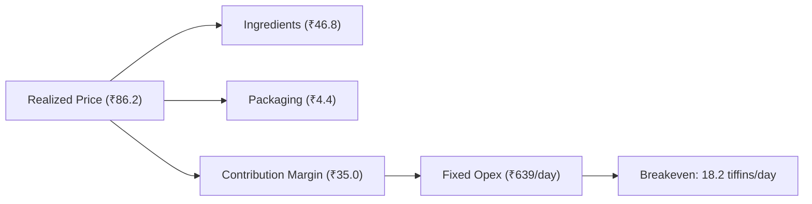

# Maa Ki Rasoi Cloud Kitchen: Performance & Intelligence Brief

**Period:** `last_30d` | **As Of:** `2026-10-10T19:10:00+05:30` | **Location:** Kakadeo, Kanpur

---

## 1. Executive Summary

- Revenue reached ₹55,320 from 639 tiffins with a net profit of ₹9,574 (17.3% margin).
- Liquid cash stands at ₹12,000 with ₹1,900 headroom over the mandatory ₹5,000 safety buffer.
- Unit contribution margin is ₹35.04 per meal, requiring 18.2 meals daily to break even.
- Rising ingredient costs (chiefly edible oil) added ₹0.00 per meal over the past 90 days.
- Active customer base holds at 96 (64.6% recurring subscription share).

---

## 2. Key Performance Indicators

| Metric | Primary Period (last_30d) | Baseline Comparison | Delta (%) |
|---|---|---|---|
| **Meals Sold** | 639 | 650 | -1.69% |
| **Gross Revenue** | ₹55,320.00 | ₹56,255.00 | -1.66% |
| **COGS** | ₹26,545.72 | ₹27,003.98 | -1.7% |
| **Gross Margin** | 52.0% | 52.0 | +0.0 pts |
| **Operating Expenses** | ₹19,200.54 | ₹19,146.84 | +0.28% |
| **Net Operating Profit** | ₹9,573.74 | ₹10,104.18 | -5.25% |
| **Net Profit Margin** | 17.3% | 18.0 | -0.7 pts |
| **Avg Revenue / Meal** | ₹86.57 | ₹86.55 | +0.02% |
| **Subscriber Revenue Share** | 67.3% | 67.8 | - |
| **Monthly Recurring Revenue (MRR)** | ₹158,100.00 | - | - |
| **Annual Run-Rate (ARR)** | ₹1,897,200.00 | - | - |

---

## 3. Unit Economics & Cost Drivers

Unit economics for **Standard Veg Tiffin** (menu price ₹90 one-off, ₹85 subscriber):
- **Realized Blended Price:** ₹86.24
- **Ingredients COGS:** ₹46.80
- **Packaging Cost:** ₹4.40
- **Total Unit COGS:** ₹51.20
- **Contribution Margin:** ₹35.04 (40.6%)
- **Breakeven Volume:** $\text{breakeven} = \frac{\text{opex}}{\text{contribution}} = \frac{639}{35.04} = 18.2$ tiffins/day.

---

## 4. Top Operational Risks & Opportunities

### Top Risks
- **Tight liquidity minimum on 2026-10-12** (ALERT): Cash dips to ₹6,900, leaving only ₹1,900 headroom above safety buffer.
- **Immediate morning ingredient shortfalls** (ALERT): Shortfalls detected on oil and containers before tomorrow's production starts.
- **Edible oil cost inflation pass-through** (NOTICE): Sunflower oil price rose from ₹138 to ₹146/L, compressing contribution margins.

### Top Opportunities
- **Afternoon unutilized delivery slot capacity**: Kitchen has 14 unbooked slots available for student/office delivery tomorrow. *Impact:* Up to 14 incremental daily meal sales without expanding fixed kitchen shifts.
- **High subscription customer retention**: Recurring subscribers generate 67.3% of revenue with low cancellation rates. *Impact:* Stable recurring working capital that cushions weekend dips.
- **Wholesale packaging bulk discounting**: Packaging accounts for ₹4.40 per meal; container supplier delivery SLA arrives by 07:00. *Impact:* Direct margin expansion if container volume is aggregated.

---

## 5. Appendix: System Warnings & Data Health

- **Data Coverage:** 30 days recorded.
- **Active System Warnings:**
  - Memory conflict detected on 1 key(s): supplier.gupta.oil_price_per_l
  - Low forecast confidence (0.45) on 2026-10-20 (Dussehra)
  - Low forecast confidence (0.58) on 2026-10-22
  - Low forecast confidence (0.55) on 2026-10-23
  - Low forecast confidence (0.50) on 2026-10-24
  - Bottom-up COGS (59.4%) differs from reported ledger COGS (48.0%) by 11.4 pts.
